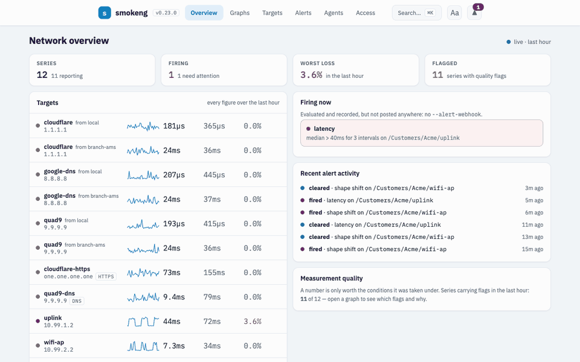
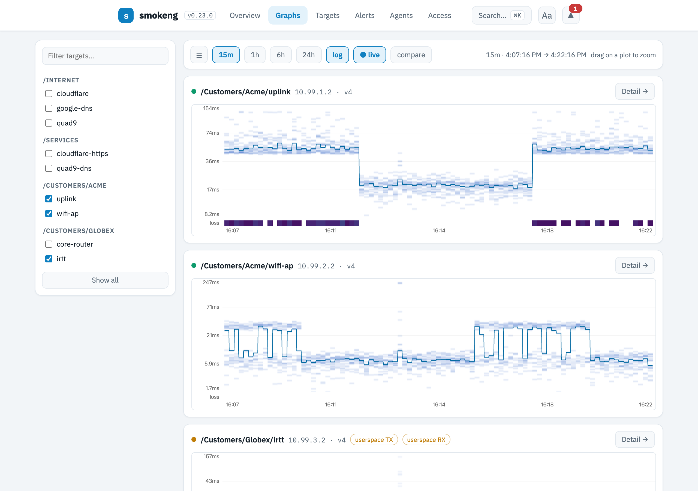
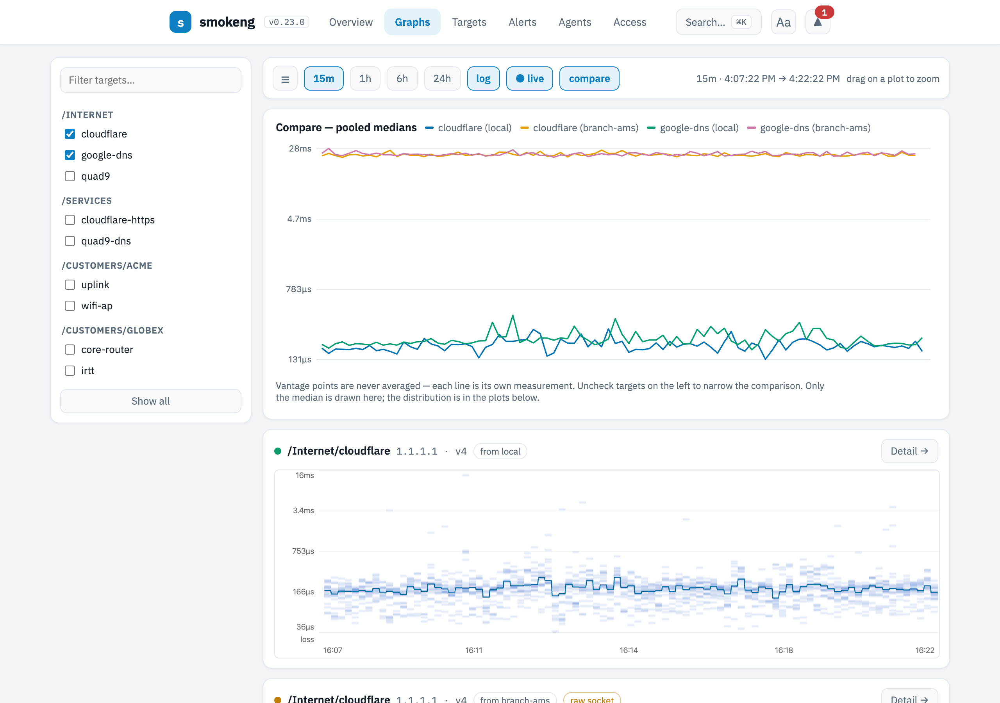
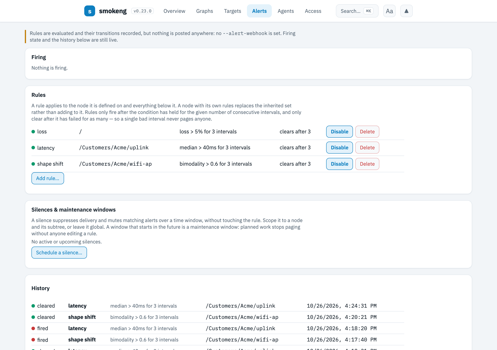
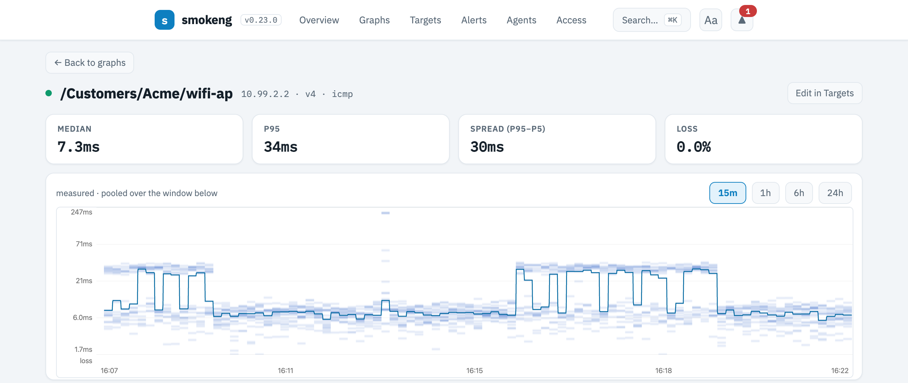
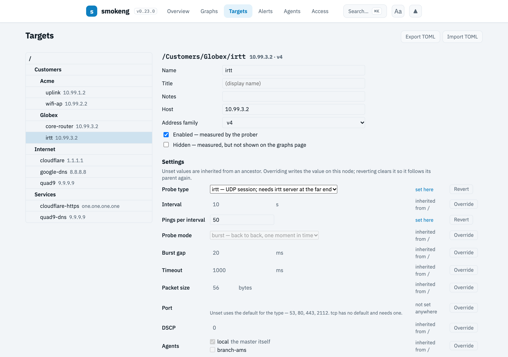
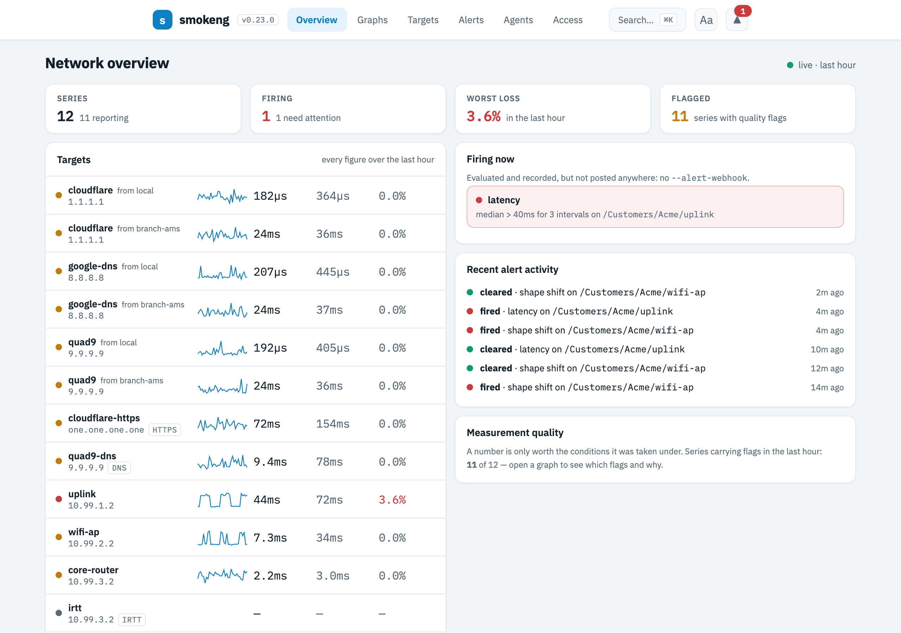

<div align="center">

# smokeng

### See the shape of your network, not its average.

Self-hosted latency and packet-loss monitoring that keeps every round-trip time, alerts when the distribution changes shape, and flags any measurement it can't vouch for.

[](https://github.com/Timdebruijn/smokeng/releases/latest) [](https://github.com/Timdebruijn/smokeng/actions/workflows/ci.yml) [](LICENSE)

[Quick start](#quick-start) · [Why](#averages-lie) · [Compare](#how-it-compares) · [Limits](#limits-up-front) · [Docs](docs/README.md)



</div>

A ground-up rebuild of the idea [SmokePing](https://oss.oetiker.ch/smokeping/) made famous, in Go and
React. One static binary with the UI embedded and SQLite inside: no Perl, no RRDtool, no CGI, no
Prometheus stack to stand up first.

## Averages lie

It's 21:00. The video call stutters, the backup crawls. By 23:00 it's fine again. You call the ISP;
their test says your line averages 12 ms. They're not lying, exactly: nine pings in ten take 8 ms and
one takes 50, and that averages to about 12. A median can sit *between* two paths and describe neither.
And a monitor that rolls last month into hourly averages has already thrown away the evenings you
were trying to prove.

smokeng is built on one rule:

> **Never present a number claiming more certainty than is known.**

Three things follow from it.

**1. Nothing is averaged away.** Every interval's full set of RTTs is stored at the resolution it was
measured, and drawn as density smoke at every zoom level. A tight band, a haze, a long tail and two
separate bands look different, because they are different faults. Change the interval or the ping
count later and the history stays: every row describes itself.

**2. It alerts on shape, not just thresholds.** Next to loss, median, p95 and spread, a `shape` rule
fires when the distribution drifts from its baseline (Wasserstein distance) and a `bimodality` rule
when one path turns into two, against a rolling baseline or a "golden" window you capture. The firing
alert shows reference and current distribution overlaid. Rules fire once and clear once, with
hysteresis both ways, and their state survives a restart.

**3. It flags its own faults.** ICMP and DNS are kernel-timestamped on Linux. Anything that isn't, and
any interval with dropped replies, a clock step or an ICMP error, carries a badge on the graph, so you
can tell "the network was bad" from "the monitor was busy". Intervals that are smokeng's own fault are
kept out of the alert metrics they would distort. No data is drawn as a gap, never as a line or a
fake 0%, and real loss under 0.1% reads `<0.1%`, not `0.0%`.



## Quick start

Linux (amd64 below; arm64, arm and 386 builds too, plus macOS for development):

```bash
# 1. Download and verify
curl -fsSLO https://github.com/Timdebruijn/smokeng/releases/latest/download/smokeng-linux-amd64
curl -fsSL  https://github.com/Timdebruijn/smokeng/releases/latest/download/SHA256SUMS |
  grep smokeng-linux-amd64 | sha256sum -c -
chmod +x smokeng-linux-amd64 && sudo mv smokeng-linux-amd64 /usr/local/bin/smokeng

# 2. Allow unprivileged ICMP (no root, no setuid helper), now and after a reboot
echo 'net.ipv4.ping_group_range = 0 2147483647' | sudo tee /etc/sysctl.d/99-smokeng.conf
sudo sysctl -p /etc/sysctl.d/99-smokeng.conf

# 3. Say what to measure
cat > targets.toml <<'EOF'
[defaults]
interval_s = 60
pings_per_interval = 20

[targets."Internet/cloudflare"]
host = "1.1.1.1"
address_family = "v4"

[targets."Internet/quad9"]
host = "9.9.9.9"
address_family = "v4"
EOF
smokeng config import --db smokeng.db targets.toml

# 4. Run
smokeng serve --db smokeng.db --listen 127.0.0.1:8080
```

Open <http://127.0.0.1:8080>. The first measurements land after one interval; the smoke reads well
after a few. Without OIDC configured, smokeng listens on loopback only.
Next: [Getting started](docs/getting-started.md) · [hardened systemd service](docs/operations.md) ·
[Ansible role](deploy/ansible). There is no container image yet.

**Coming from SmokePing?** Bring your `Targets` file:

```bash
smokeng config import-smokeping --dry-run /etc/smokeping/config.d/Targets   # preview
smokeng config import-smokeping --db smokeng.db /etc/smokeping/config.d/Targets
```

The tree, per-node settings and probe types come across; anything it can't translate is warned
about, never silently dropped. RRD history can't come along: it was already consolidated.
[Migrating from SmokePing →](docs/migrating-from-smokeping.md)

## Built for three jobs

**Prove it to your ISP.** Measure your gateway, the ISP's first hop and a public resolver, and read
them on one shared crosshair: "my link" and "their network" separate at a glance. When the evening
loss shows up, it is in the graph with timestamps and in an [availability report](docs/reading-graphs.md)
you can download as CSV. Availability is always shown next to coverage, so a gap passes for neither
uptime nor downtime.

**Find the cause.** Six probe types, each producing a real RTT distribution: `icmp`, `dns`, `tcp`,
`http`, `https` and `irtt`. A resolver that crawls behind a box that pings fine, TCP where ICMP is
rate-limited, HTTPS for what users actually wait on. Route changes are marked on the same time axis.
Drop an agent elsewhere and compare vantage points: each one is its own series, never averaged.

**Run it for other people.** One subtree per customer or site, an agent at each. OIDC grants scope a
group to its subtree, and that subtree is presented as the whole installation: foreign targets don't
look forbidden, they look like they don't exist. (Grants restrict nothing until you start the server
with `--default-role none`.) [Access control →](docs/access-control.md)



## What else is in the box

| | |
|---|---|
| **Remote agents** | The same binary in another mode. Push-only, so they work behind NAT. One-time enrolment tokens, Ed25519-signed requests, first write wins, and a local buffer that rides out a master outage and back-fills the graphs. Agents receive data, never code. [Agents →](docs/agents.md) |
| **Alerting** | Loss, median, p95, spread, shape and bimodality. Acknowledge, silences and booked maintenance windows built in; delivery to an Alertmanager v2 webhook. [Alerting →](docs/alerting.md) |
| **Target tree** | Settings inherit down the tree, and the admin UI shows per value whether it is set here or inherited, and from where. [Configuration →](docs/configuration.md) |
| **GitOps** | The whole configuration, alert rules and grants included, round-trips through one TOML file. Import is declarative: absent targets are disabled, not deleted. |
| **Access** | OIDC login (Authentik, Keycloak, Entra, Okta, …). Viewer and editor grants per subtree; admin is global. [Access control →](docs/access-control.md) |
| **Reports** | Availability per vantage point over 24 h, 7 d or 30 d, with an outage list, CSV export and an API. |
| **Operations** | Prometheus `/metrics` for smokeng's own health, documented systemd hardening, an Ansible role, and releases with SHA256SUMS and signed build provenance. [Operations →](docs/operations.md) |
| **Accessibility** | Higher-contrast, larger-text and colour-blind-safe palettes; ⌘K / Ctrl+K jumps to any target. |

<table>
<tr>
<td width="50%" valign="top"></td>
<td width="50%" valign="top"></td>
</tr>
<tr>
<td valign="top"></td>
<td valign="top"></td>
</tr>
</table>

<details>
<summary><b>Under the hood: storage, probes and quality flags</b></summary>

**What is stored.** One row per target, vantage point and interval: sent, received, a quality
bitfield, an ICMP error code, and the sorted RTTs in microseconds as delta-varints. Nothing is
averaged or downsampled when it is written, when it ages or when it is drawn. At a 60 s interval
that is about **28 MB per series per year** ([estimate and examples](docs/operations.md#storage-growth));
SQLite stays comfortable into the low thousands of series. Retention is opt-in per subtree and
deletes whole intervals; it never coarsens them.

**How it measures.**

| Probe | Measures | Timestamps on Linux |
|---|---|---|
| `icmp` | echo request to reply, unprivileged datagram socket | kernel, both directions |
| `dns` | query to answer; the target is the resolver | kernel, both directions |
| `tcp` | SYN to completed handshake | userspace, flagged |
| `http` / `https` | request to response, fresh connection, TLS included | userspace, flagged |
| `irtt` | UDP session against an irtt server you run | userspace, flagged |

`probe_mode` sends the N probes of an interval as a **burst** or **spreads** them across it.

**Quality flags**, shown as badges on the graph:

| Badge | What it tells you |
|---|---|
| `userspace TX` / `RX` | scheduler jitter is in the number; the smoke is wider than the network |
| `raw socket` | the `ping_group_range` sysctl is not set; accuracy unaffected |
| `dropped replies` | the socket receive queue overflowed, so some of the loss is smokeng's |
| `clock step` | wall clock and monotonic clock diverged; those RTTs are not trusted |
| ICMP error, by name | "administratively prohibited" is a different finding from silence |
| `send refused` | the local stack would not transmit; counted as lost, not drawn as empty |

The data model, encoding and render pipeline: [DESIGN.md](DESIGN.md) and
[Reading the graphs](docs/reading-graphs.md).

</details>

## How it compares

Every tool here is good at what it was built for.

| | **smokeng** | **SmokePing** | **Uptime Kuma** | **blackbox_exporter + Grafana** |
|---|---|---|---|---|
| Built for | Latency and loss distributions | Latency and loss distributions | Up/down and response time | General probing in a Prometheus stack |
| Per-interval distribution | Every sample, never consolidated | Per round, consolidated in RRD as it ages | One value per check | One value per scrape; `smokeping_prober` adds histograms |
| Alert on distribution shape | Shape and bimodality rules | Threshold and pattern matchers | Up/down, response time | PromQL on what you stored |
| Notification channels | Alertmanager webhook | Email, scripts | Many built in | Alertmanager |
| Multiple vantage points | Signed push agents, buffered | Master/slave | Not natively | One exporter per site |
| Deploy | One static binary | Perl, RRDtool, CGI, a web server | Node or Docker | Exporter, Prometheus, Grafana |
| Maturity | Young, one maintainer | Proven over two decades, still maintained | Large community | Industry standard |

**Pick something else if** you need status pages or many notification channels (Uptime Kuma, Gatus),
you are happy with per-scrape values inside an existing Prometheus stack (blackbox_exporter), or you
want hop-by-hop MTR graphs (smokeng records whether the route changed, not per-hop latency).

2026 also brought other SmokePing successors, each with real strengths: **smokestack** stores
DDSketch histograms with bounded error, which keeps storage small and percentiles accurate across
rollups; **heliograph** keeps raw samples on TimescaleDB with mTLS agents; **smoketrace** puts
traceroute and latency on one time axis. smokeng's trade-off is exact samples at about 28 MB per
series per year, with shape alerting, self-flagged measurements and subtree tenancy on top.

## Limits, up front

- **Latency-shaped probes only.** No up/down checks, no SNMP, no status pages.
- **One notifier:** an Alertmanager v2 webhook. Email, chat and escalation go through Alertmanager.
- **Linux for real measurements.** Kernel timestamps, drop counting, clock-step detection and path
  discovery are Linux-only; macOS works for development with every measurement flagged.
- **`tcp`, `http(s)` and `irtt` are userspace-timed**, and say so on the graph.
- **SQLite scale:** comfortable into the low thousands of series. No downsampling, by design.
- **No local accounts:** OIDC, or unauthenticated on loopback. Agents need NTP within ±5 minutes.
- **No container image yet;** a binary, systemd units and an Ansible role.
- **One maintainer.** Security reports go through [SECURITY.md](SECURITY.md).

## Documentation

[Getting started](docs/getting-started.md) · [Configuration](docs/configuration.md) ·
[Reading the graphs](docs/reading-graphs.md) · [Alerting](docs/alerting.md) ·
[Remote agents](docs/agents.md) · [Authentication](docs/authentication.md) ·
[Access control](docs/access-control.md) · [Operations](docs/operations.md) ·
[Migrating from SmokePing](docs/migrating-from-smokeping.md) · Why it's built this way: [DESIGN.md](DESIGN.md)

## Build from source

```bash
git clone https://github.com/Timdebruijn/smokeng.git && cd smokeng
make build   # Go 1.27+; no Node needed, web/dist is committed
make check   # what CI runs
```

Or `go install github.com/timdebruijn/smokeng/cmd/smokeng@latest`.

## License

MIT, see [LICENSE](LICENSE). Every release ships `THIRD-PARTY-NOTICES`; nothing copyleft is linked in.

---

<div align="center">

**Your ISP says the line is fine. Go get the graph.**

[Download the latest release](https://github.com/Timdebruijn/smokeng/releases/latest) ·
[Getting started](docs/getting-started.md) · ⭐ Star the repo if it found something for you

</div>
